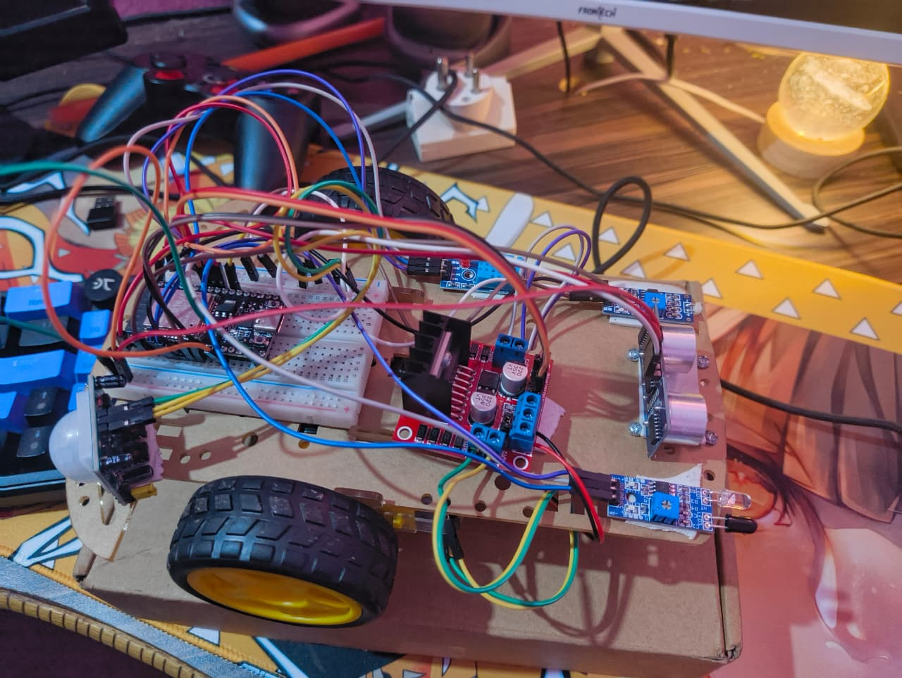
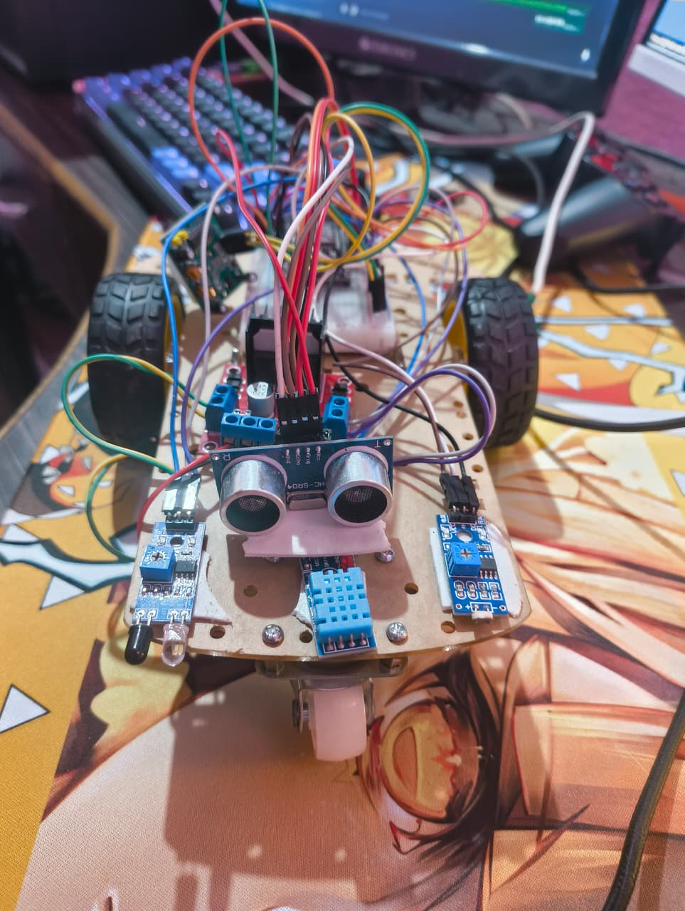
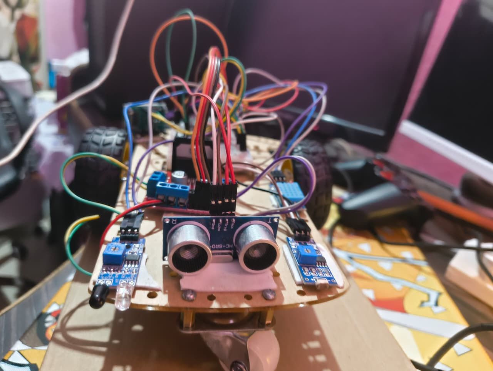
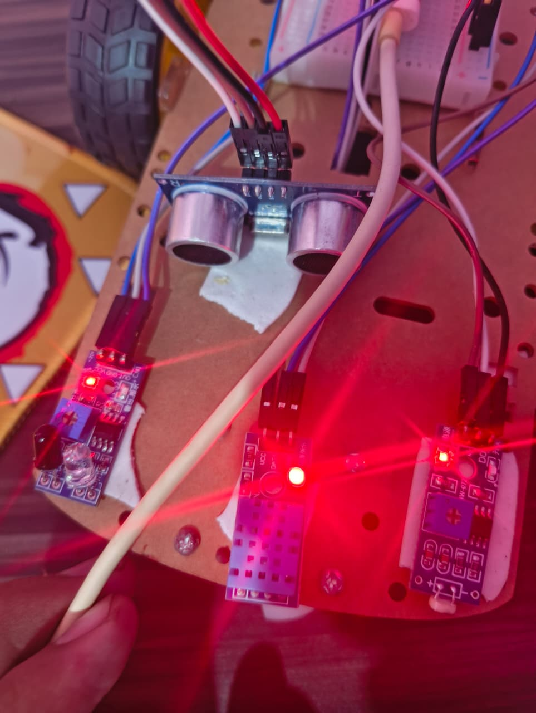
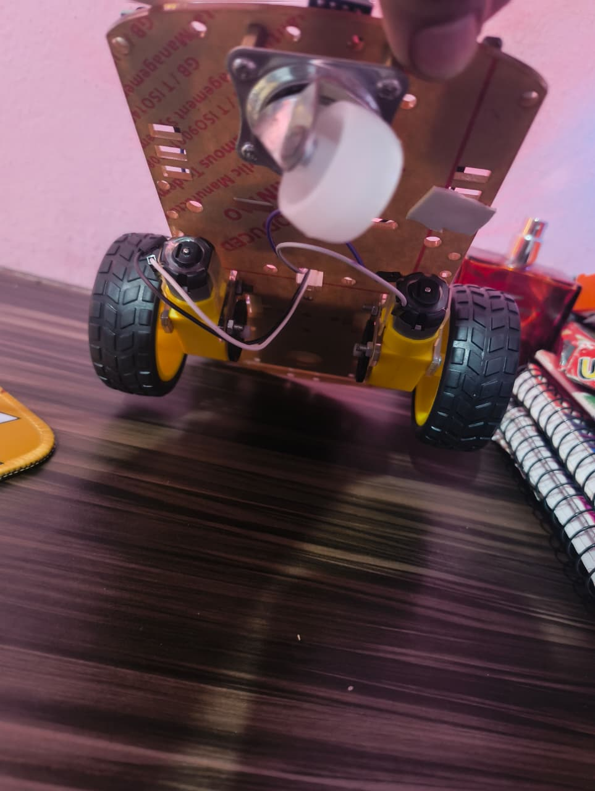

# 🤖 Micro-ROS Enabled Autonomous Environmental Rover

[](https://www.espressif.com/)
[](https://micro.ros.org/)
[]()
[](https://flask.palletsprojects.com/)

A comprehensive autonomous environmental mapping rover built on ESP32, featuring differential drive with hardware PWM motor speed modulation, dual obstacle detection (Ultrasonic Radar + Infrared Collision Beam), ambient environmental sensing (DHT11 Temperature & Humidity, LDR Light), and real-time bidirectional telemetry streaming over Wi-Fi and USB.

Developed as part of the **Centurion University B.Tech CSE Robotics (ROS with C++)** curriculum.

---

## 📸 Key Capabilities

1. **Hardware PWM Accelerator Speed Control:**
   - 1 kHz, 8-bit LEDC hardware PWM channels for gentle creep, cruise, and turbo throttle.
   - Web-based tactile accelerator slider and `+` / `-` keyboard shortcuts.
2. **Multi-Tier Smart Obstacle Avoidance:**
   - **Continuous Ultrasonic Scanning (HC-SR04):**
     - `> 60 cm`: Full cruise speed (`180/255` PWM).
     - `35 – 60 cm`: Caution approach (`130/255` PWM).
     - `18 – 35 cm`: Creep mode (`80/255` PWM).
     - `< 10 cm`: Immediate brake → reverse back → scan left clearance → scan right clearance → navigate into the widest open corridor.
   - **Front Active-Low IR Beam (TCRT5000 / KY-032):** Instantaneous physical collision emergency brake.
3. **Dual Telemetry & Driving Mission Control:**
   - **Standalone Untethered SoftAP Mode:** Rover generates its own Wi-Fi hotspot (`MicroROS-Rover` / `rover1234`) and directly hosts an embedded dashboard at `http://192.168.4.1`.
   - **LAN / Local Wi-Fi Bridge:** Python Flask server provides high-performance data bridge with Chart.js live waveform graphing, accessible on any smartphone/laptop at `http://<your-mac-ip>:8080`.
4. **Environmental Mapping:**
   - Live DHT11 ambient temperature & humidity logging.
   - Ambient illumination tracking with optical thresholding (Bright/Dark).

---

## 📐 Pinout & Hardware Architecture

### 1. Pin Mapping Table

| Subsystem | Module / Device | Pin on ESP32 | Description / Function |
|---|---|---|---|
| **Motor (Right)** | L298N IN1 | **GPIO 18 (`D18`)** | Right Motor Direction / PWM Ch 0 |
| **Motor (Right)** | L298N IN2 | **GPIO 19 (`D19`)** | Right Motor Direction / PWM Ch 1 |
| **Motor (Left)** | L298N IN3 | **GPIO 26 (`D26`)** | Left Motor Direction / PWM Ch 2 |
| **Motor (Left)** | L298N IN4 | **GPIO 27 (`D27`)** | Left Motor Direction / PWM Ch 3 |
| **Ultrasonic** | HC-SR04 Trig | **GPIO 5 (`D5`)** | Ultrasonic 10µs Trigger pulse output |
| **Ultrasonic** | HC-SR04 Echo | **GPIO 39 (`VN`)** | Ultrasonic Return pulse input (Safe input-only) |
| **IR Collision** | IR Proximity OUT | **GPIO 33 (`D33`)** | Digital Obstacle Detect (Active-LOW: 0=blocked, 1=clear) |
| **Environment** | DHT11 DATA | **GPIO 32 (`D32`)** | Single-wire Temperature & Humidity bus |
| **Environment** | LDR DO | **GPIO 25 (`D25`)** | Digital Light Threshold (1=Bright, 0=Dark) |
| **Power** | 7.4V Li-ion / 5V | **VIN & GND** | Common Ground with L298N & Sensors |

> ⚠️ **Critical Wiring Rules:**
> - **HC-SR04 VCC** MUST be powered from **`5V / VIN`**, not 3.3V, otherwise the acoustic transducer will not emit sound bursts.
> - **L298N GND and ESP32 GND** must be physically connected together (Common Ground).
> - Keep **GPIO 12 (MTDI)** and **GPIO 3 (RX0)** free from motor/trigger lines to avoid strapping pin flash corruption during boot.

---

## 📸 Hardware Gallery & Visual Build Guide

| Isometric Assembly | Top-Down Chassis View |
|:---:|:---:|
|  |  |
| *Fully wired dual-wheel differential chassis with L298N & ESP32* | *Central power distribution & component layout* |

| Front Radar & Proximity Sensors | Active Sensor Array | Undercarriage & Motors |
|:---:|:---:|:---:|
|  |  |  |
| *HC-SR04 Radar, IR Proximity, DHT11 & LDR* | *Front sensor cluster with status LEDs active* | *TT DC Geared Motors & Front Free Caster Wheel* |

---

## 🗂️ Repository Structure

```
Micro-ROS-Autonomous-Rover/
├── docs/
│   ├── Micro-ROS Autonomous Rover Development (1).pdf   # Course specification & project requirements
│   ├── rover_full_assembly_isometric_view.jpeg          # Fully assembled rover chassis
│   ├── rover_chassis_top_down_view.jpeg                 # Overhead component distribution view
│   ├── rover_front_radar_and_proximity_sensors.jpeg     # Frontal obstacle sensor array
│   ├── sensor_array_front_view_active_leds.jpeg         # Operational sensor array with active LEDs
│   ├── rover_undercarriage_motors_and_caster.jpeg       # Bottom view: TT motors and caster wheel
│   └── esp32_breadboard_pinout_wiring.jpeg              # ESP32 breadboard pin breakout view
├── firmware/
│   ├── rover_web_telemetry/
│   │   └── rover_web_telemetry.ino                      # Production firmware (PWM, SoftAP, Web Server, Smart Auto)
│   └── rover_hardware_test/
│       └── rover_hardware_test.ino                      # Step-by-step pin & actuator calibration suite
├── server/
│   ├── app.py                                           # Flask serial-to-web telemetry bridge
│   ├── requirements.txt                                 # Python dependencies
│   └── static/
│       └── index.html                                   # Glassmorphism cyber-HUD telemetry dashboard
├── tools/
│   └── rover_hardware_cli.py                            # Interactive CLI diagnostic terminal
├── .gitignore
└── README.md
```

---

## ⚡ Step-by-Step Setup & Assembly Guide

### Step 1: Chassis & Motor Driver Wiring (L298N)
1. Mount the two TT yellow DC motors to the 2WD rover chassis.
2. Connect Right Motor wires to **OUT1 & OUT2** of the L298N.
3. Connect Left Motor wires to **OUT3 & OUT4** of the L298N.
4. Keep the black **ENA** and **ENB** 5V jumpers installed on the L298N board.
5. Connect your battery pack (+7.4V / 2x 18650 cells) to the **12V terminal** of the L298N and negative to **GND**.
6. Run a jumper wire from **L298N GND** to an **ESP32 GND** pin.
7. Connect logic inputs:
   - `IN1` ➔ ESP32 **GPIO 18**
   - `IN2` ➔ ESP32 **GPIO 19**
   - `IN3` ➔ ESP32 **GPIO 26**
   - `IN4` ➔ ESP32 **GPIO 27**

### Step 2: Sensors Wiring
1. **HC-SR04 Ultrasonic:**
   - `VCC` ➔ ESP32 `VIN` (5V)
   - `GND` ➔ ESP32 `GND`
   - `Trig` ➔ ESP32 `GPIO 5`
   - `Echo` ➔ ESP32 `GPIO 39` (`VN`)
2. **DHT11 Sensor:**
   - `VCC` ➔ ESP32 `3V3`
   - `GND` ➔ ESP32 `GND`
   - `DATA` ➔ ESP32 `GPIO 32`
3. **IR Proximity Sensor:**
   - `VCC` ➔ ESP32 `3V3`
   - `GND` ➔ ESP32 `GND`
   - `OUT` ➔ ESP32 `GPIO 33`
4. **LDR Module:**
   - `VCC` ➔ ESP32 `3V3`
   - `GND` ➔ ESP32 `GND`
   - `DO` ➔ ESP32 `GPIO 25`

---

## 💻 Flashing Firmware to ESP32

### Option A: Using Arduino IDE
1. Open **Arduino IDE** (v2.x recommended).
2. Install the **ESP32** board package (`esp32 by Espressif Systems`) via Boards Manager.
3. Install required libraries from Library Manager:
   - `DHT sensor library by Adafruit`
   - `Adafruit Unified Sensor`
4. Connect the ESP32 to your computer via micro-USB.
5. Select Board: **`ESP32 Dev Module`** (or `ESP32-WROOM-DA Module`).
6. Select Port: `/dev/cu.usbserial-0001` (Mac) or `COMx` (Windows).
7. Open `firmware/rover_web_telemetry/rover_web_telemetry.ino`.
8. Click **Upload** (Ctrl+U / Cmd+U).

### Option B: Using `arduino-cli` (Command Line)
```bash
arduino-cli compile --fqbn esp32:esp32:esp32da firmware/rover_web_telemetry
arduino-cli upload -p /dev/cu.usbserial-0001 --fqbn esp32:esp32:esp32da firmware/rover_web_telemetry
```

---

## 🌐 Running the Mission Control Web Dashboard

### 1. Direct Untethered Field Access (ESP32 SoftAP Hotspot)
1. Turn on the rover battery switch.
2. On your phone or laptop, connect to the Wi-Fi network:
   - **SSID:** `MicroROS-Rover`
   - **Password:** `rover1234`
3. Open any mobile browser and go to:
   👉 **`http://192.168.4.1`**

### 2. High-Tech Cyber-HUD Dashboard via Python (Local Wi-Fi)
1. Install Python dependencies:
   ```bash
   pip3 install -r server/requirements.txt
   ```
2. Start the telemetry server:
   ```bash
   python3 server/app.py
   ```
3. Open in your browser:
   - Local Mac: **`http://localhost:8080`**
   - Smartphone / Tablet on same Wi-Fi: **`http://<YOUR_LAN_IP>:8080`**

### 🎮 Driving Controls:
- **D-Pad Touch Buttons:** Hold to drive, release to brake immediately.
- **Keyboard Driving:** `W` (Forward), `A` (Spin Left), `S` (Backward), `D` (Spin Right), `Spacebar` (Emergency Stop).
- **Speed Slider / Accelerator:** Drag to modulate between 60 (gentle creep) and 255 (full throttle), or use `+` / `-` keys.
- **Autonomous Mode Switch:** Toggle between Manual Control and Smart Autonomous Obstacle Avoidance.

---

## 🔬 Hardware Diagnostic Calibration

Before running long autonomous missions, verify all actuators and sensors using the included test suite:
```bash
python3 tools/rover_hardware_cli.py
```
This runs an interactive sequence:
- Left wheel forward/backward calibration.
- Right wheel forward/backward calibration.
- Synchronous dual-wheel drive.
- Live real-time stream of Ultrasonic, DHT11, LDR, and IR values.

---

## 📜 License & Acknowledgments
Developed for academic research and robotics education at **Centurion University of Technology and Management**. Open source under the **MIT License**.

